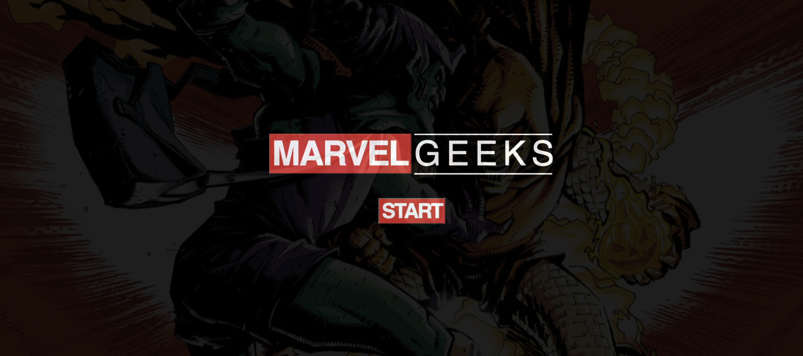

# Marvel Geeks Fandom Page

Welcome to the Marvel Geeks Fandom Page, a place for all Marvel fans to explore the vast universe of Marvel comics and movies. This React application uses the Marvel API to fetch data about comics and the IMDB API to fetch movie data, creating a rich, interactive experience for any Marvel enthusiast.

## Features

- Displays a range of Marvel comics and movie information.
- Includes search functionality for easy navigation.
- Offers detailed views with modals for individual comics and movies.

## Setup

1. Clone the repository.
2. Run `npm install` to install dependencies.
3. Start the application with `npm start`.
4. Create a `.env` file for your API keys:
   ```
   REACT_APP_MARVEL_API_KEY='your_marvel_api_key'
   REACT_APP_IMDB_API_KEY='your_imdb_api_key'
   ```

## Scripts

- `npm start`: Starts the development server.
- `npm test`: Runs the test suite.
- `npm run build`: Builds the app for production.
- `npm run eject`: Ejects the build setup (irreversible).

## Dependencies

- React, ReactDOM, React-Router-DOM
- Axios
- Crypto-JS

## Deployment

Deployed Application Link: [Marvel Geeks Fandom Page](https://marvel-geeks-0345e598bc8e.herokuapp.com/)

To deploy your own version, use `npm run build` and deploy the `build` directory to your hosting service.

## Screenshots


